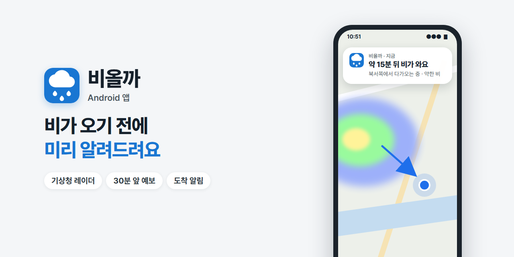

<p align="center">
  
</p>

# 비올까

기상청 강수 레이더로 내 주변 150km의 비구름을 계속 지켜보다가, 비가 내 위치로 다가오면
"약 15분 뒤 비가 와요"처럼 미리 알려주는 Android 앱입니다.

**[앱 받기 → ribs.kr/raining-now](https://www.ribs.kr/raining-now)** · 지도만 보기: [ribs.kr/rain-assist](https://www.ribs.kr/rain-assist)

> 개인이 쓰려고 만든 앱입니다. 기상청 공식 예보가 아니며, 예보는 30분 앞까지만 보고 틀릴 수 있습니다.
> Android 12 이상에서 동작하고, Play 스토어가 아닌 APK로 나눠 줍니다.

## 주요 기능

- **도착 알림**: 비구름의 이동 속도와 방향을 분석해 "N분 뒤 비가 와요", "지금 비가 오고 있어요",
  "비가 그쳤어요"를 알려줘요.
- **백그라운드 감시**: 앱을 꺼 두어도 포그라운드 서비스가 주변 레이더를 계속 확인해요.
- **강수 레이더 지도**: 실시간 레이더 위에 비구름이 오는 방향을 화살표로 보여주고, 앞으로 30분 동안의
  분 단위 비 세기를 그래프로 볼 수 있어요. 도로 CCTV 실시간 영상도 볼 수 있어요.
- **앱 안 업데이트**: 새 버전이 나오면 앱을 열 때 알려주고, 앱 안에서 바로 받아 설치해요.
- **위치는 폰 안에서만**: 비 예보는 폰에서 계산하고, 내 위치 좌표를 서버로 보내거나 저장하지 않아요.

## 처음 켤 때 요청하는 권한

| 권한 | 이유 |
|---|---|
| 알림 | 비가 다가오거나 그치면 알려주려고 |
| 위치 (정확한 위치, 항상 허용) | 앱을 꺼 두어도 내 주변의 비를 지켜보려고 |
| 배터리 최적화 제외 | 백그라운드 감시가 중간에 끊기지 않게 |

## 기술 스택

- Kotlin, Jetpack Compose
- WebView (강수 레이더 지도: [ribs.kr/rain-assist](https://www.ribs.kr/rain-assist))
- FusedLocationProviderClient (위치 기반 예측)
- Foreground Service + 배터리 최적화 예외 (백그라운드 상시 감시)
- minSdk 31 / targetSdk·compileSdk 36

## 빌드 & 실행

```bash
./gradlew assembleDebug
adb install -r app/build/outputs/apk/debug/app-debug.apk
```

배포용 빌드(`assembleRelease`)는 배포 키가 필요합니다. `keystore.properties.example`을 참고하세요.

## 더 알아보기

아키텍처, 레이더 분석 알고리즘, 웹 연동 인터페이스 규격, 배포·업데이트 방식은
[DEVELOPMENT.md](DEVELOPMENT.md)를 참고하세요.

레이더 자료: 기상청 · 도로 CCTV: 국가교통정보센터(ITS)
